# Mellow Admin

**Template dashboard admin bergaya *clay & glass*: lembut di mata, siap dipakai, dan mudah dikembangkan.**

React 19 · 37 layar siap pakai · Tanpa CDN atau internet · Lisensi MIT · [Versi 1.3.0](CHANGELOG.md)

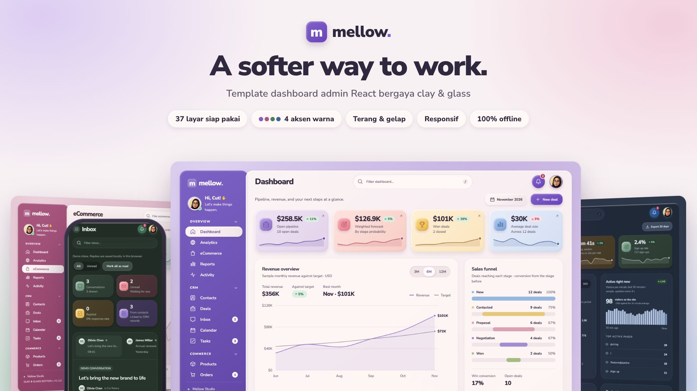

Mellow Admin adalah template frontend untuk aplikasi CRM, back-office, dan SaaS. Kebanyakan template admin terlihat kaku dan seragam. Mellow memakai kartu bervolume ala tanah liat (*clay*), sentuhan kaca buram (*glass*) pada dialog dan layar masuk, dan palet pastel, sehingga dashboard terasa hangat tanpa mengorbankan kepadatan informasi.

Cukup ekstrak lalu buka `index.html`. Tidak perlu `npm install`, server, atau koneksi internet untuk melihat hasilnya.

---

## Kenapa Mellow?

- **Tampil beda sejak layar pertama.** Bayangan neumorphic, sentuhan kaca, animasi masuk yang membal lembut, dan 4 palet aksen lengkap memberi identitas visual yang jarang ada di template admin.
- **Langsung jalan, bahkan offline.** React, CSS, ikon, dan font Nunito Sans sudah dibundel lokal. Tanpa CDN, font eksternal, atau panggilan API.
- **Ada versi satu file.** `Mellow-Admin-Standalone.html` (±747 KB) memuat seluruh aplikasi dalam satu berkas HTML. Praktis untuk demo ke klien atau lampiran presentasi.
- **Ringan.** Bundle JavaScript, termasuk React, enam foto kontak, dan foto profil, ±183 KB setelah gzip. CSS ±58 KB gzip, sudah termasuk font yang tertanam.
- **Kode yang mudah dibaca.** Hanya enam berkas sumber, React murni tanpa router, state library, atau framework CSS. Satu orang bisa memahami seluruh alurnya dalam satu sore.
- **Siap disambungkan ke backend.** Semua perubahan data lewat beberapa fungsi pusat, jadi mengganti `localStorage` dengan API Laravel, Node, atau backend lain cukup di satu tempat.

---

## Galeri

Semua gambar diambil langsung dari template ini dengan data demo bawaan. Aksen warna dan mode gelap bisa diganti kapan saja dari **Settings → Appearance**, tanpa memuat ulang halaman.

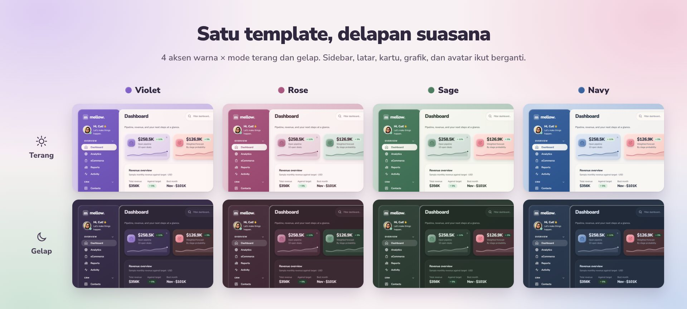

| **Analytics** · navy, gelap. Trafik harian, pengunjung aktif, dan halaman teratas. | **eCommerce** · rose, terang. Penjualan, checkout funnel, dan antrean pengiriman. |
|---|---|
| 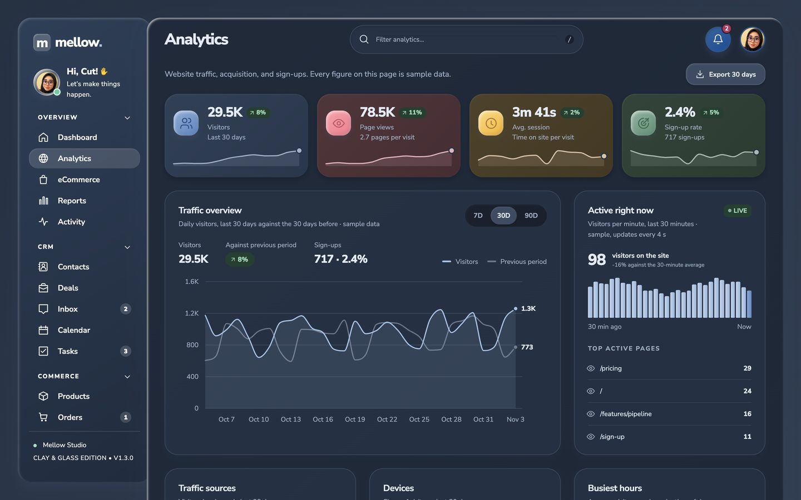 | 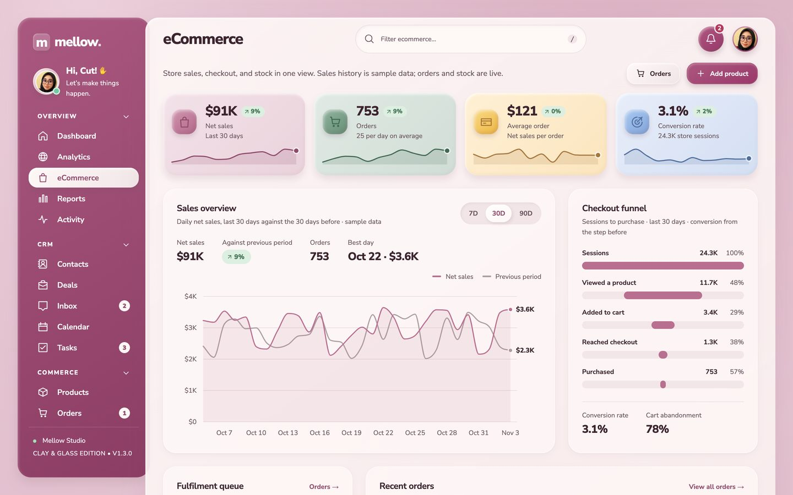 |
| **Deals** · violet, terang. Kanban pipeline dengan drag-and-drop dan konfeti saat deal *Won*. | **Inbox** · sage, gelap. Percakapan, balasan, dan deal terkait dalam satu layar. |
| 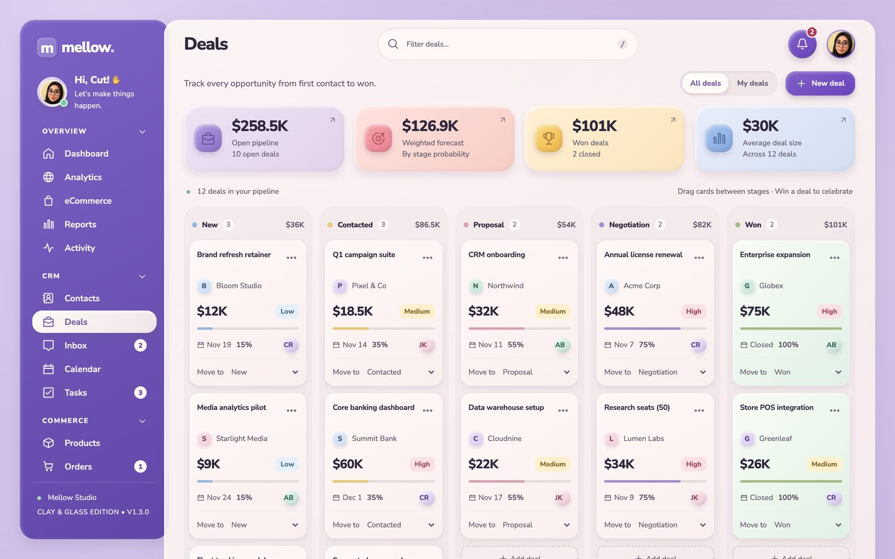 | 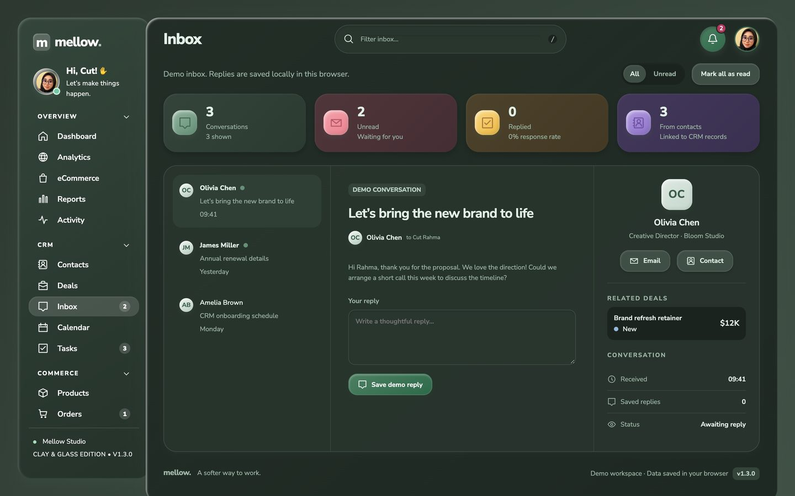 |
| **Reports** · rose, gelap. Pendapatan bulanan dan nilai pipeline per tahap. | **Calendar** · navy, terang. Agenda, tenggat tugas, dan jadwal closing deal. |
| 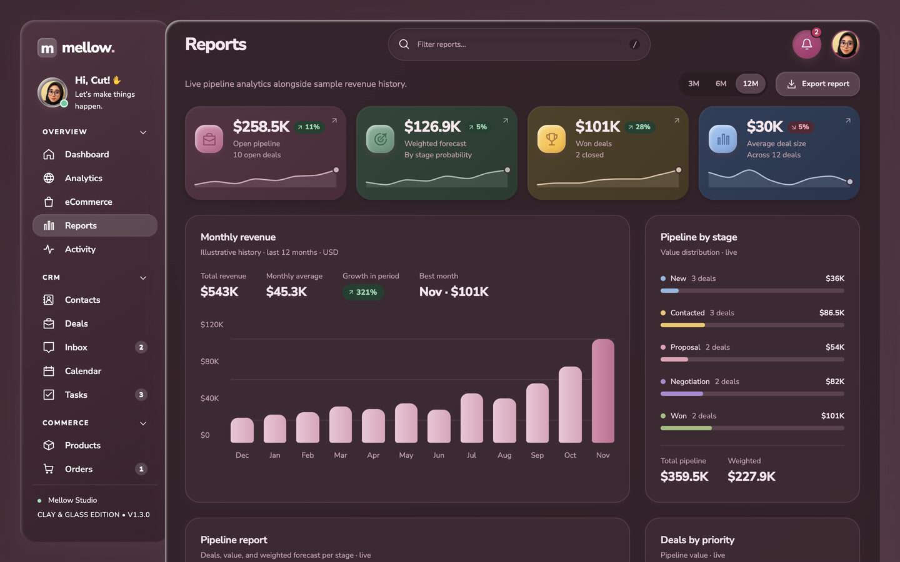 | 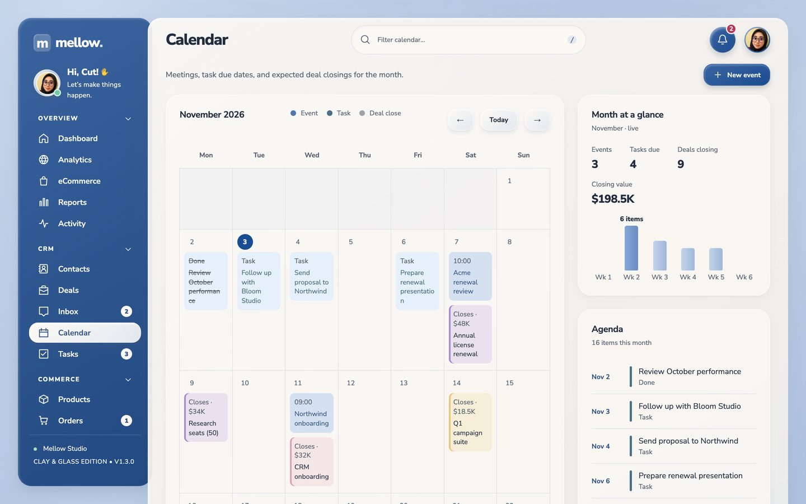 |
| **Contacts** · sage, terang. Kartu kontak berfoto dengan ringkasan deal. | **Icon set** · violet, gelap. 67 ikon dengan pratinjau ukuran dan salin JSX atau SVG. |
| 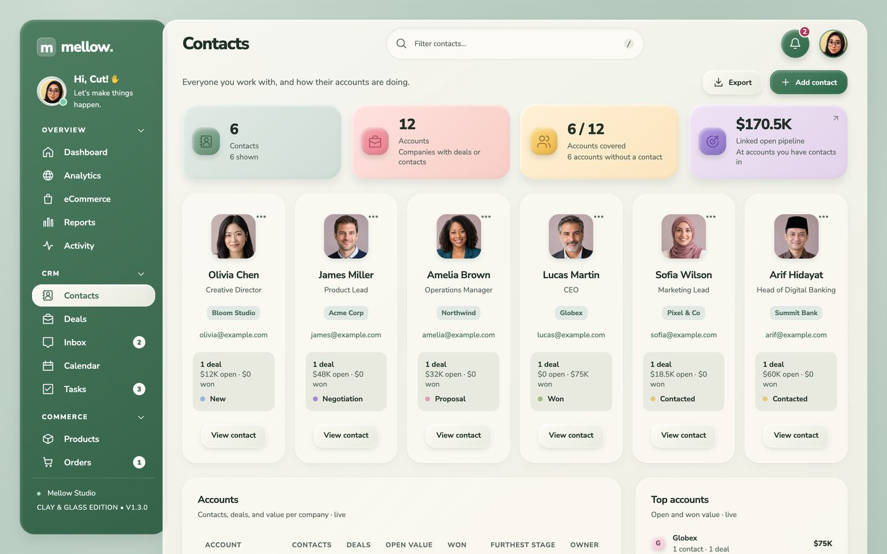 | 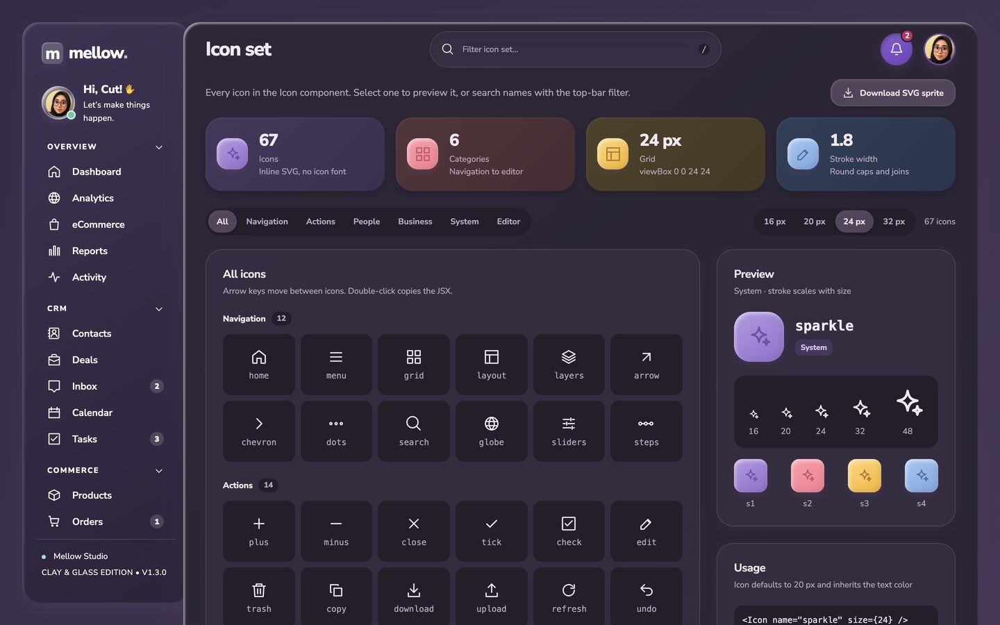 |
| **Advanced inputs** · rose, terang. Tag input, slider rentang, stepper, dan rating bintang. | **Lock screen** · navy, gelap. Jam berjalan dan ringkasan selama Anda pergi. |
| 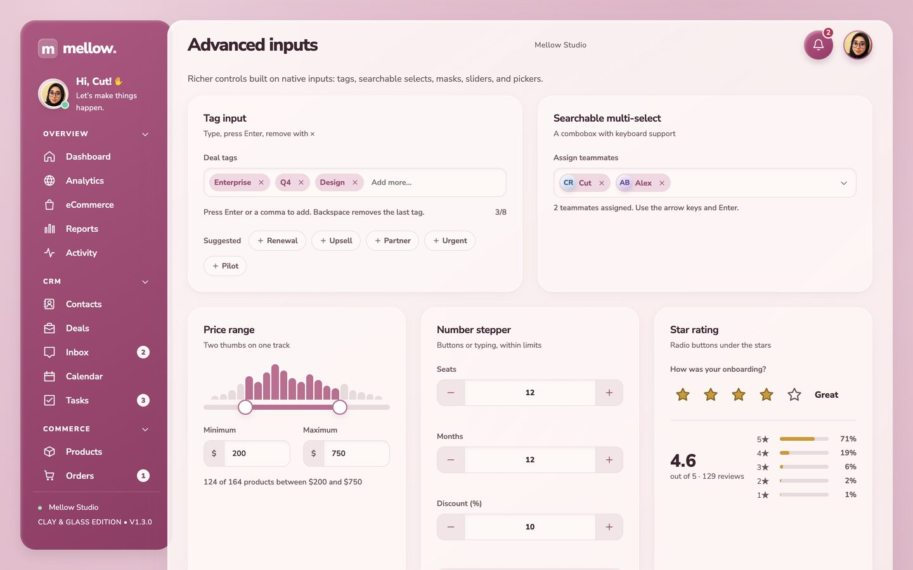 | 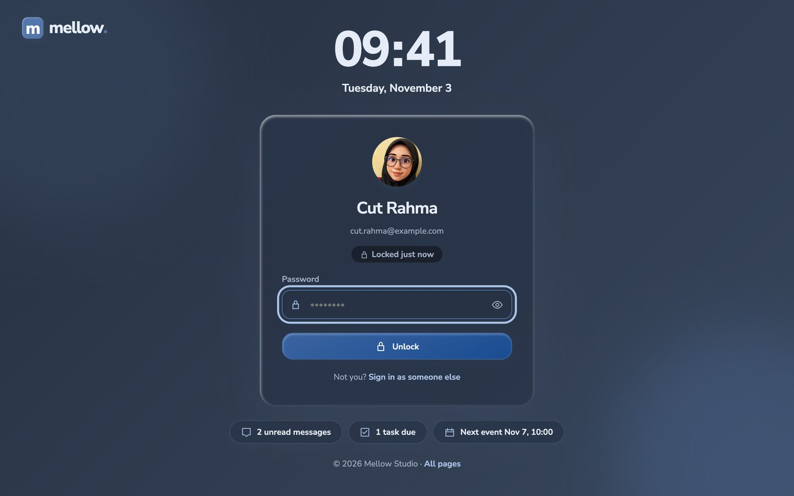 |
| **Sign in** · sage, terang. Carousel, tombol SSO, dan tampilkan sandi. | **Error 404** · violet, gelap. Pencarian halaman dan tautan cepat. |
| 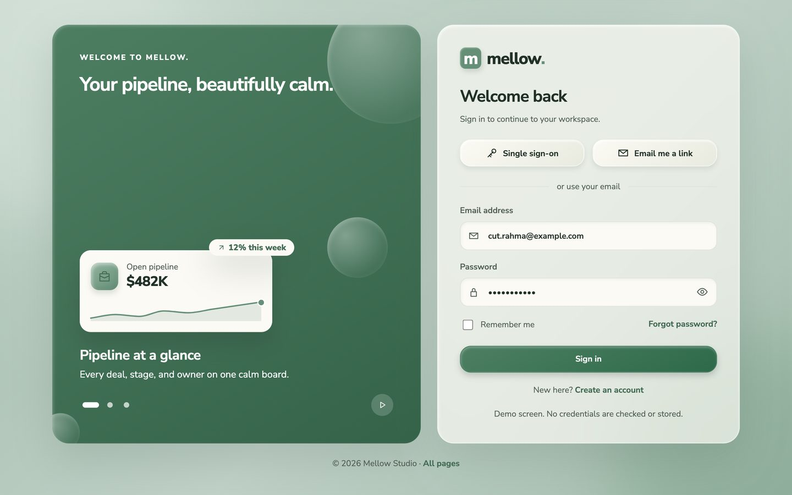 | 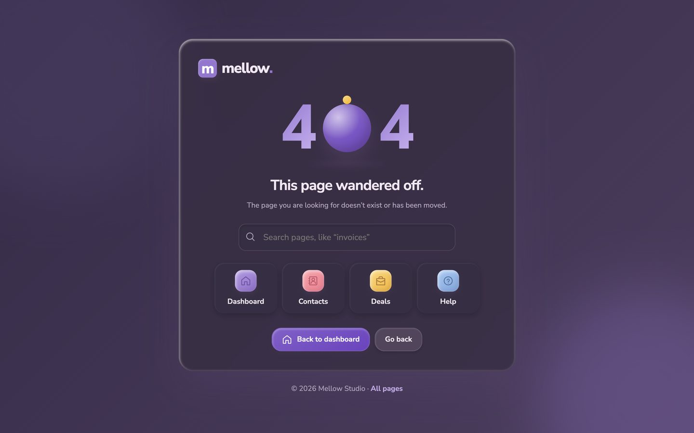 |

Di ponsel, sidebar berubah menjadi menu geser, navigasi utama pindah ke dock di bawah layar, dan papan kanban bisa digulir menyamping.

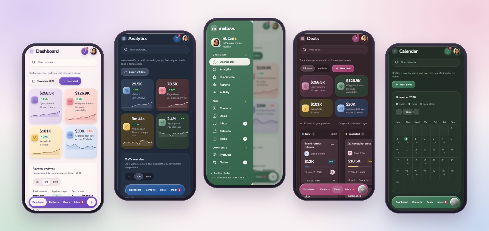

---

## Fitur

### 37 layar siap pakai

Sidebar dikelompokkan seperti template admin profesional:

| Kelompok | Halaman |
|---|---|
| **Overview** | Dashboard (CRM), Analytics, eCommerce, Reports, Activity |
| **CRM** | Contacts, Deals (kanban), Inbox, Calendar, Tasks |
| **Commerce** | Products, Orders, Invoices |
| **Workspace** | Projects, Files, Team |
| **Account** | Profile, Billing, Settings, Help |
| **UI kit** | Components, Pages, Icon set |
| **Forms** | Form elements, Advanced inputs, Form layouts, Validation, Wizard, Editors, File upload |

Ditambah **7 layar mandiri** tanpa sidebar: Sign in, Sign up, Forgot password, Lock screen, Error 404, Error 500, dan Maintenance. Alamat yang tidak dikenal otomatis menampilkan halaman 404. Setiap layar punya komponen dan animasinya sendiri: carousel dan tombol tampilkan sandi di Sign in, meter kekuatan sandi di Sign up, kode 6 digit di Forgot password, jam berjalan di Lock screen, pencarian halaman di 404, status layanan dengan coba ulang otomatis di 500, dan hitung mundur di Maintenance.

### Interaksi yang benar-benar berfungsi

- **Kanban pipeline** dengan drag-and-drop di desktop. Di ponsel dan keyboard tersedia pilihan *Move to* dan menu aksi •••. Memindahkan deal ke *Won* memunculkan konfeti.
- **CRUD lengkap** untuk deal, kontak, tugas, agenda kalender, produk, proyek, dan anggota tim. Menghapus satu record langsung terjadi dengan tombol *Undo*; aksi massal seperti reset data tetap meminta konfirmasi.
- **Ringkasan dihitung dari data:** total pipeline, *weighted forecast* per probabilitas tahap, nilai deal won, rata-rata deal, nilai stok, dan pendapatan pesanan.
- **Filter per halaman** dari kotak di bilah atas (tekan `/`), ditambah filter status atau kategori.
- **Ekspor CSV** untuk kontak, invoice, produk, pesanan, tim, dan laporan pipeline. Sel diamankan dari *formula injection* saat dibuka di Excel.
- **Activity log otomatis.** Setiap penambahan, perubahan, dan penghapusan tercatat di timeline Activity dan di halaman Profile.
- **Invoice siap cetak**, tandai invoice dibayar, ubah status pesanan langsung di tabel, ubah peran anggota tim, dan tabel hak akses per peran.
- **File manager demo** dengan folder dan pemakaian penyimpanan. Unggahan hanya mencatat nama dan ukuran file.
- **Inbox** dengan penanda belum dibaca, notifikasi di bilah atas, dan balasan yang tersimpan lokal.
- **Help center** dengan FAQ yang bisa dicari dan formulir kontak support.

### Tampilan dan tema

- **4 palet aksen:** violet, rose, sage, dan navy. Aksen mengubah seluruh nuansa, bukan hanya tombol dan sidebar: latar, permukaan kartu, teks, grafik, kartu statistik, avatar, bayangan, backdrop dialog, dan konfeti. Tiap aksen punya versi terang dan gelap.
- **Animasi masuk *clay pop*.** Setiap kali halaman dibuka, konten muncul berurutan dari atas ke bawah. Kartu dan panel naik dengan pantulan kecil, ikon statistik memantul, baris tabel dan kartu deal bergeser masuk, batang grafik tumbuh, dan progress bar terisi. Semuanya selesai dalam kurang dari 2 detik. Sidebar dan bilah atas tetap diam. Record yang ditambahkan, dipindah, atau dikembalikan dengan *Undo* langsung muncul tanpa menunggu giliran.
- **Mode gelap** dan **mode kartu ringkas**, masing-masing bisa dinyalakan dari Settings.
- **Sidebar menempel** saat halaman digulir, dengan grup menu yang bisa dilipat.
- **Responsif penuh.** Sidebar berubah menjadi ikon di tablet, dan di ponsel menjadi menu geser dengan dock navigasi di bawah. Kanban bisa digulir menyamping di layar kecil.
- **Token desain berbasis CSS variable** untuk tipografi, spasi, radius, warna semantik, bayangan, dan kurva animasi, sehingga mengganti warna merek cukup di satu tempat.

### Aksesibilitas dan detail kecil

- Kontras teks lolos WCAG AA (4,5:1) di mode terang dan gelap, untuk keempat aksen warna.
- Dialog memakai elemen `<dialog>` bawaan: tutup dengan Escape, dan fokus kembali ke tombol asal.
- Menu aksi ••• bisa dipakai dengan keyboard (panah, Home, End, Escape).
- Label `aria` pada tombol ikon, grafik, dan kontrol tahap.
- Ada alternatif keyboard untuk drag-and-drop.
- Menghormati `prefers-reduced-motion`: bila pengguna memilih mengurangi gerakan di sistem operasinya, semua animasi dan transisi dimatikan.
- Gaya cetak khusus untuk invoice.

---

## Mulai cepat

1. Ekstrak seluruh isi paket ke satu folder.
2. Buka `index.html` di peramban modern. Folder `assets/` harus tetap di sebelahnya.
3. Atau buka `Mellow-Admin-Standalone.html` untuk versi satu file.

Untuk penyimpanan data yang konsisten, jalankan server lokal. Perlakuan `localStorage` pada `file://` berbeda-beda antar peramban.

```bash
python3 -m http.server 8080
# buka http://localhost:8080
```

## Pengembangan

Butuh Node.js 20 atau lebih baru.

```bash
npm ci          # pasang React 19 dan esbuild sesuai lockfile
npm run build   # bangun ulang assets/, versi standalone, dan folder dist/
```

Setelah build, muat ulang peramban. Untuk hosting statis, unggah isi folder `dist/`. Navigasi memakai hash URL (`#deals`, `#billing`, dan seterusnya), jadi tidak perlu aturan rewrite di server.

### Struktur proyek

```text
src/
  App.jsx          Shell aplikasi, navigasi, state bersama, modal record, dan halaman Deals
  pages.jsx        Semua halaman lain dan layar mandiri (login, error, maintenance)
  forms.jsx        Tujuh halaman kelompok Forms (elemen, layout, validasi, wizard, editor, unggah)
  components.jsx   Komponen UI: Icon, Button, Menu, Modal, Field, StatCard, RevenueChart, ...
  data.js          Data contoh, paket harga, FAQ, dan format angka
  styles.css       Token desain, tema, animasi, breakpoint, dan gaya cetak
assets/            Hasil build (jangan diedit langsung)
dist/              Paket siap unggah ke hosting
build.mjs          Skrip build esbuild dan pembuat versi standalone
PANDUAN.html       Panduan lengkap berbahasa Indonesia
CHANGELOG.md       Riwayat perubahan per versi
```

---

## Kustomisasi

| Ingin… | Caranya |
|---|---|
| Mengganti warna merek | Ubah token di `:root` pada `src/styles.css`: warna merek (`--accent*`, `--primary-a/b`, `--sidebar-a/b`), latar (`--bg-*`), permukaan dan teks, `--shade`, grafik (`--bar*`), kartu statistik pertama (`--stat-1*`), dan avatar pertama (`--tone-0*`). Pastikan teks putih di tombol dan sidebar tetap berkontras minimal 4,5:1 |
| Menambah aksen warna | Tambahkan nama aksen ke daftar swatch di halaman Settings (`src/pages.jsx`) dan buat `.swatch.nama` di CSS. Lalu salin blok `[data-accent=rose]` dan `[data-theme=dark][data-accent=rose]` sebagai contoh, dan ganti semua nilainya |
| Mengatur animasi masuk | Ubah durasi atau kurva pada aturan `enter-*` dan token `--ease-out`/`--ease-spring` di `src/styles.css`. Animasi hanya berlaku pada elemen yang tercantum di daftar selektornya, jadi jenis kartu atau baris baru perlu ditambahkan ke daftar itu agar ikut beranimasi |
| Memakai Rupiah | Ubah helper `money` dan `short` di `src/data.js`, lalu sesuaikan nilai data contoh |
| Menambah halaman | Tambahkan entri ke array `nav` (label, ikon, kelompok), lalu render komponennya di `App.jsx` (komponen halaman biasanya diletakkan di `src/pages.jsx`). Halaman formulir cukup ditambahkan ke daftar `forms` di `src/forms.jsx` |
| Mengganti data contoh | Edit `seed` di `src/data.js`, build ulang, lalu klik **Settings → Reset demo data** |
| Menerjemahkan antarmuka | Teks UI ada di `App.jsx`, `pages.jsx`, `forms.jsx`, dan `components.jsx` |

## Integrasi backend

Mellow adalah lapisan frontend. Untuk aplikasi produksi, sambungkan ke backend pilihan Anda, misalnya Laravel, Node.js, atau Go:

1. Sajikan `index.html` dan `assets/` dari direktori publik aplikasi.
2. Ganti pembacaan data contoh dan `localStorage` dengan panggilan API.
3. Hubungkan `saveRecord`, `patch`, `move`, dan `remove` di `App.jsx` ke endpoint server. Karena `remove` menawarkan *Undo*, kirim `DELETE` setelah toast berakhir atau sediakan endpoint pemulihan.
4. Tambahkan status loading, pesan galat, dan rollback ketika server menolak perubahan.
5. Terapkan autentikasi, validasi, otorisasi, dan perlindungan CSRF di server. Layar Sign in dan Sign up sudah siap disambungkan.

Contoh rancangan endpoint (belum disertakan dalam paket):

```text
GET    /api/deals          POST   /api/deals
PATCH  /api/deals/{id}     DELETE /api/deals/{id}
GET    /api/contacts       GET    /api/products     GET /api/orders
GET    /api/reports/pipeline
```

---

## Batasan

Kami ingin Anda tahu persis apa yang Anda dapatkan:

- Ini **template frontend dengan data demonstrasi**, bukan CRM jadi. Belum ada login server, hak akses nyata, database, pengiriman email, atau payment gateway.
- Layar login, daftar, dan billing **hanya tampilan**. Kredensial dan data kartu tidak diperiksa atau disimpan.
- Data tersimpan di `localStorage` per peramban. Jangan memasukkan data sensitif sebelum backend dan kontrol akses siap.
- Grafik pendapatan historis berisi angka ilustratif. Sambungkan ke API agregasi untuk penggunaan produksi.
- Pengujian dilakukan di Chromium, termasuk viewport ponsel 390 px. Perangkat fisik Android/iOS, Safari, dan Firefox belum diuji secara khusus.

## Lisensi

Kode template © 2026 Syams Ideris, dirilis dengan [Lisensi MIT](LICENSE.txt): bebas dipakai, dimodifikasi, dan dijual kembali sebagai bagian dari proyek Anda. Lisensi React, React DOM, Scheduler, dan font Nunito Sans (SIL OFL 1.1) yang ikut dibundel tercantum di [THIRD-PARTY-NOTICES.txt](THIRD-PARTY-NOTICES.txt).

---

**Mellow Admin. *A softer way to work.***
Buka `index.html`, pilih aksen favorit Anda, dan mulai bangun dashboard yang enak dilihat setiap hari.
